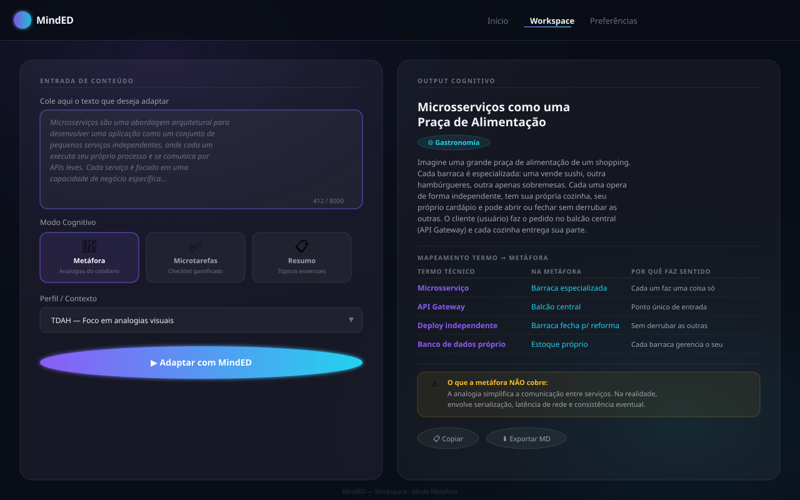
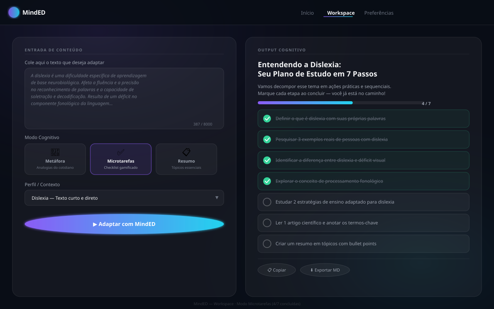

# MindED

**Estação cognitiva para neurodivergentes.** Adapta textos densos em metáforas do cotidiano, microtarefas acionáveis ou resumos semânticos de alto contraste — usando IA generativa (Gemini) e um design glassmorphism acessível.

Nasceu como projeto de Iniciação Científica sobre acessibilidade cognitiva. Evoluiu para um produto open-source.

---

## Demonstração visual

| Modo Metáfora | Modo Microtarefas |
|:---:|:---:|
|  |  |

---

## O problema

Pessoas neurodivergentes (TDAH, dislexia, autismo) e estudantes lidando com conteúdos técnicos densos frequentemente encontram:

- **Sobrecarga de memória de trabalho** — conceitos abstratos sem âncora contextual
- **Paralisia por excesso de informação** — dificuldade em decompor um assunto em etapas
- **Fadiga visual** — interfaces poluídas que causam dispersão imediata

## A solução

Quatro lentes de assimilação do mesmo conteúdo:

| Modo | O que faz |
|---|---|
| 🧠 **Metáfora** | Converte a teoria em analogia do cotidiano com tabela termo → metáfora e alerta de limitações |
| ✅ **Microtarefas** | Gera checklist sequencial e gamificado com barra de progresso em tempo real |
| 📋 **Resumo Semântico** | Sintetiza em tópicos com palavras-chave em negrito para leitura dinâmica |
| ❓ **Perguntas** | Gera perguntas de compreensão com dica e resposta para consolidar o que foi lido |

---

## Estrutura do projeto

```
MindED/
├── index.html          # Landing page
├── workspace.html      # Workspace principal (two-column layout)
├── preferencias.html   # Preferências e controle dos dados locais
├── termos.html         # Termos de Uso
├── privacidade.html    # Política de Privacidade
├── src/
│   ├── css/
│   │   └── base.css    # Design system completo (tokens, glass, botões, header)
│   └── js/
│       └── demo-data.js # Resultados prontos da demonstração sem login
├── api/
│   ├── main.py         # FastAPI — POST /adapt e POST /extract-url
│   ├── test_main.py    # Testes da API (pytest)
│   ├── Dockerfile      # Imagem para publicar a API
│   ├── requirements.txt
│   ├── .env.example
│   └── README.md       # Instruções detalhadas do backend
├── img/
│   └── logominded.png
└── docs/
    ├── demo-metaphor.svg
    └── demo-checklist.svg
```

---

## Início rápido

### Frontend

Abra qualquer HTML diretamente no navegador ou sirva com um servidor local:

```bash
# Python
python3 -m http.server 5500

# Node
npx serve .
```

Acesse `http://localhost:5500`.

### Backend (API Python)

```bash
cd api
python3 -m venv .venv && source .venv/bin/activate
pip install -r requirements.txt
cp .env.example .env   # adicione sua GEMINI_API_KEY
# para testar sem login Firebase, adicione AUTH_DISABLED=true ao .env
uvicorn main:app --host 127.0.0.1 --port 8000 --reload
```

A API sobe em `http://127.0.0.1:8000`. Documentação interativa: `/docs`.

Testes: `pip install pytest && pytest test_main.py`.

### Publicação

O frontend está no Firebase Hosting; a API precisa de um host próprio (a imagem de `api/Dockerfile` serve para isso). Depois de publicar:

1. Defina no host uma `GEMINI_API_KEY` com faturamento ativo — e nunca `AUTH_DISABLED`.
2. Preencha `PROD_API_BASE` no `workspace.html` com a URL pública da API.
3. Se usar outro domínio no frontend, inclua-o em `ALLOWED_ORIGINS`.
4. Preencha os campos `[PREENCHER: ...]` de `termos.html` e `privacidade.html` e faça revisão jurídica.

> **Obter chave Gemini:** [aistudio.google.com/app/apikey](https://aistudio.google.com/app/apikey). A chave gratuita serve só para testes com textos fictícios. Em produção, use uma chave com faturamento ativo: os termos do Google pedem para não enviar dados pessoais ou sensíveis ao plano gratuito.

---

## Stack

| Camada | Tecnologia |
|---|---|
| Frontend | HTML + CSS (Design System próprio) + Vanilla JS |
| Backend | Python · FastAPI · Pydantic v2 |
| IA | Google Gemini (modelo configurável em `GEMINI_MODEL`) |
| Design | Glassmorphism dark · Inter + Outfit · WCAG AA |

---

## API — contrato

`POST /adapt`

```json
{
  "texto": "Cole aqui o conteúdo a adaptar (mín. 10 chars)",
  "modo": "metaphor",
  "perfil": "TDAH/Iniciante"
}
```

`modo` aceita: `metaphor` · `checklist` · `summary` · `questions`

Para vídeo, envie também `video_url` com um link público do YouTube. A API analisa até `VIDEO_MAX_SECONDS` (30 minutos) e permite `VIDEO_DAILY_LIMIT` vídeos por dia para cada usuário.

As chamadas exigem `Authorization: Bearer <Firebase ID token>`.

Resposta completa segue o schema `AdaptationResponse` em [`api/main.py`](api/main.py).

---

## Segurança

- `GEMINI_API_KEY` exclusivamente via variável de ambiente — nunca hardcoded
- Token do Firebase verificado no servidor em todas as rotas que usam IA ou buscam links
- Limite de pedidos por usuário e por minuto (por processo)
- O nome do perfil (TDAH, autismo etc.) não chega ao Gemini: a API o converte em orientações de escrita
- `/extract-url` bloqueia endereços internos, inclusive em redirecionamentos
- CORS restrito às origens em `ALLOWED_ORIGINS`
- A chave `apiKey` do Firebase no frontend é pública por definição; a proteção vem das regras e dos domínios autorizados

---

## Licença

MIT — livre para usar, estudar e contribuir.
